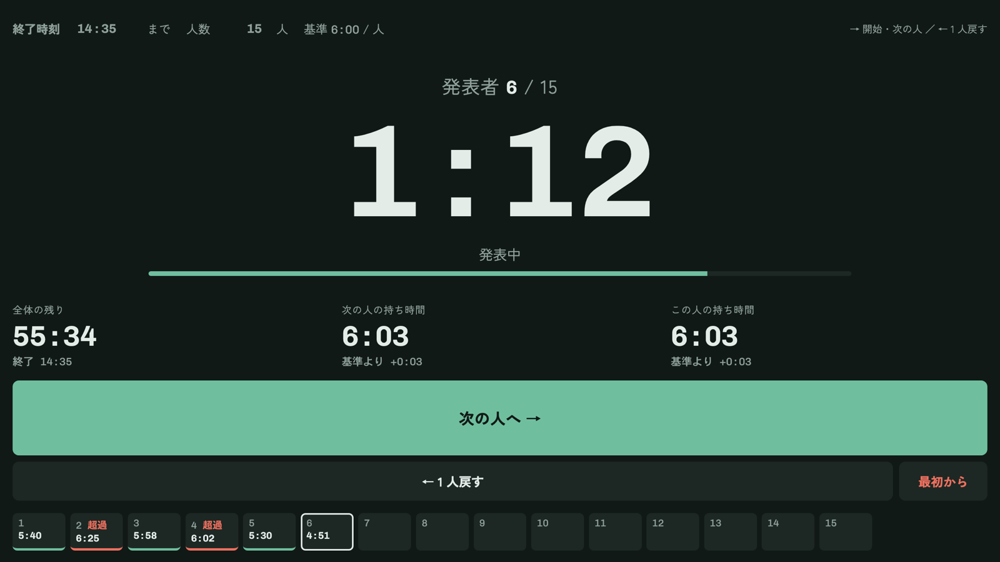

# TaktTime

A presentation timer for many speakers sharing one time slot, such as
15 talks in a 90-minute class. Each speaker's allotment is the time left
until the end divided by the speakers left, recalculated at every handover,
so an overrun is spread over everyone after.

Live: https://zero3kw.github.io/TaktTime/



- Set the end time or a length, and the number of speakers. Defaults, in
  order of priority: URL parameters, the settings of the last start,
  90 minutes from now and 10 speakers.
- URL parameters: `?end=12:10` (end time) or `?min=90` (length in minutes),
  and `n=15` (speakers), e.g. `?end=12:10&n=15`. They apply when no session
  is in progress.
- → / PageDown / Space / Enter starts and hands over to the next speaker;
  ← / PageUp undoes the last handover. Works with presentation remotes.
- State is kept in `localStorage`, so a reload continues where it was.

Plain HTML and JavaScript served by GitHub Pages from `docs/`; no build step.
To view it locally:

```
python3 -m http.server 8000 -d docs
```

The iPhone and iPad app is in
[TaktTime-Apple](https://github.com/zero3kw/TaktTime-Apple).
